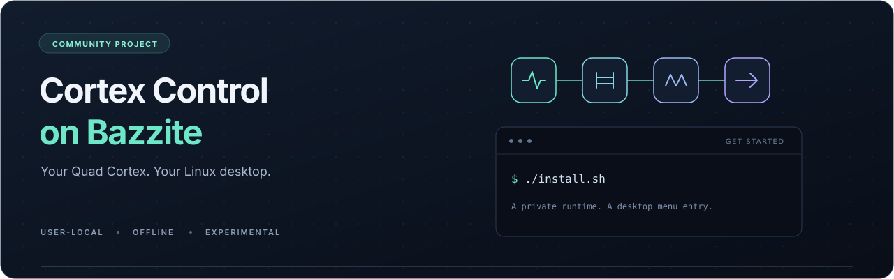

<p align="center">
  
</p>

<h1 align="center">Cortex Control on Bazzite</h1>

<p align="center">
  Run the original Windows editor from your Linux application menu.<br>
  A private Proton runtime, a guided setup, and practical recovery tools.
</p>

<p align="center">
  <a href="https://github.com/Mordeton/cortex-control-linux/actions/workflows/tests.yml"></a>
  <a href="LICENSE"></a>
  <a href="COMPATIBILITY.md"></a>
</p>

<p align="center">
  <a href="#get-started">Get started</a> ·
  <a href="#daily-use">Daily use</a> ·
  <a href="COMPATIBILITY.md">Compatibility</a> ·
  <a href="docs/TROUBLESHOOTING.md">Troubleshooting</a> ·
  <a href="CREDITS.md">Credits</a>
</p>

> [!IMPORTANT]
> **Tested on the full-size Quad Cortex only.** Quad Cortex mini has **not** been
> tested; its compatibility is unknown. This is an **experimental, offline** wrapper
> for Cortex Control 4.1.0 on x86_64 Bazzite/KDE. Cloud login, downloads and updates
> are unavailable.

## What you get

| | |
| --- | --- |
| **Desktop integration** | Open Cortex Control from KDE's application menu. A second launch can focus the existing window. |
| **A private runtime** | A local copy of Proton's Wine runtime and a dedicated prefix, independent of Steam's subsequent runtime updates. |
| **Repair and recovery** | Restore the menu entry, rebuild the installation while retaining previous copies, and check your setup with `doctor`. |

The original Windows application runs through Wine and DXVK. This project is
an independent compatibility launcher; it is not a native Linux port or an
open-source replacement for Cortex Control.

## Get started

### 1. Prepare the two inputs

- In Steam's Library, enable the **Tools** filter and install **Proton Experimental**.
- Obtain the **Cortex Control 4.1.0 Windows installer** from
  [Neural DSP's downloads page](https://neuraldsp.com/downloads).

Only the exact tested installer/executable hashes are accepted. If 4.1.0 is no
longer offered, this version of the launcher cannot install a newer app version.
Other Proton builds with the required layout are reported as untested.

### 2. Download and install

[**Download source ZIP**](https://github.com/Mordeton/cortex-control-linux/archive/refs/heads/main.zip)
and extract it, or clone the repository:

```sh
git clone https://github.com/Mordeton/cortex-control-linux.git
cd cortex-control-linux
```

From the extracted or cloned folder, run as your normal desktop user:

```sh
./cortex-control doctor
./install.sh
```

On KDE, a file picker asks for your Windows installer. Proton is detected from
Steam's default and additional libraries. Installation copies the runtime and
can take a few minutes and several GB of disk space.

### 3. Open Cortex Control

Close other QC editor sessions, connect the QC, and open **Cortex Control** from
your application menu. Linux continues to handle USB audio and MIDI.

The host needs **Python 3.11+**, `bwrap`, `lsof`, `cp`, `desktop-file-validate`,
and `7z` or `7zz`. KDE's `kdialog` provides the file picker; `wmctrl` enables
window activation. Working host Vulkan and X11/XWayland are required.
`doctor` checks prerequisites; the installer does not layer system packages.

<details>
<summary><strong>Explicit paths and existing Wine prefixes</strong></summary>

```sh
./cortex-control install \
  --installer '/path/to/Cortex Control v4.1.0.exe' \
  --runtime '/path/to/Proton - Experimental'
```

Use `--exe` instead of `--installer` for an already extracted, verified 4.1.0
executable. The application hash is also checked before every launch.
`--migrate-prefix /path/to/prefix` copies an existing prefix on first install;
its original is preserved.

</details>

## Daily use

Run these commands from this folder. After installation, you can also use
`~/.local/bin/cortex-control` with the same arguments.

| Command | Purpose |
| --- | --- |
| `./cortex-control` | Open the editor, or focus its existing window |
| `./cortex-control run --disconnected` | Open without exposing USB/HID devices |
| `./cortex-control files` | Open the import/export folder |
| `./cortex-control doctor` | Inspect the setup without opening the QC HID connection |
| `./cortex-control repair` | Restore/update launcher and menu integration |
| `./cortex-control reinstall` | Rebuild from retained verified inputs, copying existing settings |
| `./cortex-control uninstall` | Remove desktop integration and retain application files and settings |

After uninstall, `repair` restores the menu entry. Reinstall keeps previous
copies and requires extra disk space. See [storage and recovery](docs/TROUBLESHOOTING.md#storage-and-recovery)
for paths, retained configurations and interrupted installations.

## Tested scope

| Observed on the tested setup | Still unqualified |
| --- | --- |
| App rendering and QC connection | Full editing and Save/reload correctness |
| Existing-window activation and normal close | Import/export and backup/restore |
| Linux audio/MIDI alongside editor control | Long sessions, suspend/resume and hotplug |

Testing used a **full-size Quad Cortex with CorOS 4.1.1**, Cortex Control **4.1.0**,
and Bazzite/KDE with an NVIDIA RTX 2080 SUPER. Other device models, app versions,
GPUs and environments are unqualified. See the [complete compatibility record](COMPATIBILITY.md)
for the exact runtime and evidence boundaries.

For optional **QC USB 1/2 headphone playback**, see [the audio guide](AUDIO.md).
That helper is independent of the editor and is never installed automatically.

## Need help?

Start with `./cortex-control doctor` and the [troubleshooting guide](docs/TROUBLESHOOTING.md).
Diagnostics check configuration, files and visible device access; they do not
prove rendering, communication or save correctness. Review personal paths and
device details before sharing a report.

[Report a problem](https://github.com/Mordeton/cortex-control-linux/issues/new?template=bug_report.md)
with your environment, device model and redacted diagnostics.

## Disclaimer

This is an independent community project, **not affiliated with or endorsed by
Neural DSP**. Cortex Control and Quad Cortex remain Neural DSP's products and
trademarks. Obtain the proprietary app separately and follow its license terms.

This experimental wrapper is provided **as is, without warranty**, under the
[MIT license](LICENSE). Use it at your own risk; reliable operation or protection
against crashes, data loss or workflow disruption is not guaranteed.

**Back up important presets using a supported method before experimenting.**
Save/reload, import/export and backup/restore remain unqualified. Retained
installation copies are **not backups of presets on your QC**. The original app
still exposes device controls: the wrapper is not a device write filter.
Firmware updates and factory resets are outside this project's scope.

## Contributing and credits

Run the offline regression suite with:

```sh
python3 -m unittest discover -s tests -v
```

Tests use synthetic files and mocked Wine/hardware operations, with no QC or
proprietary software required. Read [contribution guidance](CONTRIBUTING.md)
before proposing compatibility changes.

- **Mordeton** — idea, requirements, direction, hardware testing and feedback.
- **GPT via OpenAI Codex** — implementation, diagnostics, tests and documentation.

[Full credits](CREDITS.md) · [MIT license for the wrapper](LICENSE)

No Windows installer, executable, runtime payload, presets or private device
captures are distributed in this repository.
